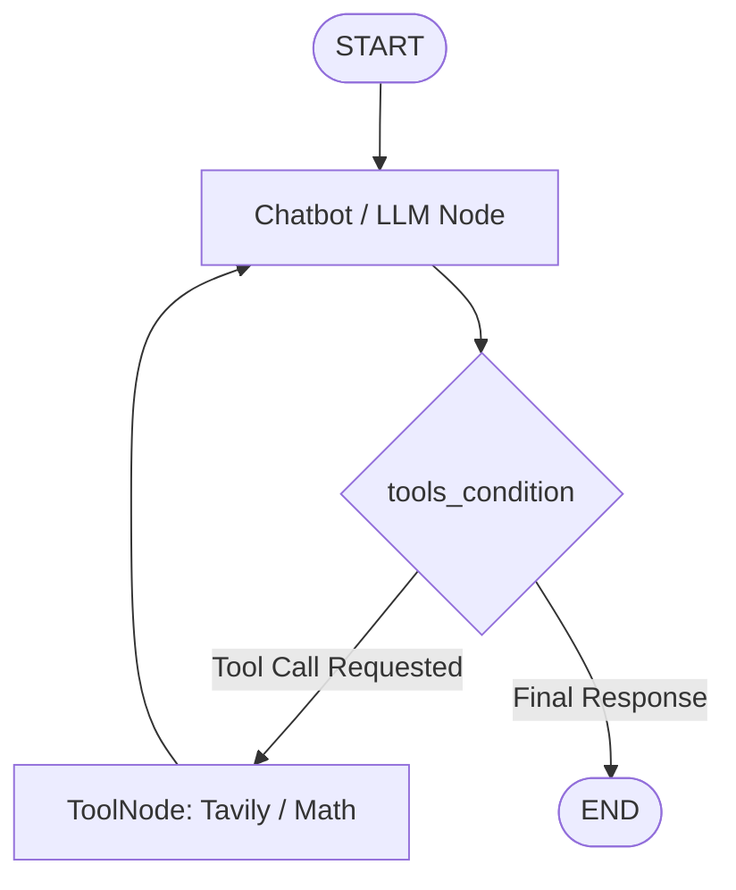

# 🤖 Basic Chatbot & ReAct Agent with Memory & Streaming

This module provides a progressive, step-by-step foundation in building conversational and agentic workflows using **LangGraph**, **LangChain**, and high-speed **Groq** LLMs. It transitions from a basic stateful chatbot to an autonomous **ReAct (Reason + Act)** tool-calling agent with persistent thread memory and real-time streaming capabilities.

---

## 📌 Key Architectural Concepts

1. **StateGraph & Custom State Management**
   - Implements custom `State` using `TypedDict` and `Annotated[list, add_messages]` as the reducer to append messages without mutating prior history.
   - Node and edge wiring using `START` and `END` boundaries.

2. **LLM & Tool Integration**
   - Powered by `ChatGroq` (`llama-3.3-70b-versatile`) via `init_chat_model`.
   - Binds external tools to the LLM:
     - **Tavily Search** (`TavilySearch`): Real-time internet search for up-to-date queries.
     - **Custom Python Tool** (`multiply`): Deterministic arithmetic execution.
   - Prebuilt `ToolNode` handles tool execution dynamically based on tool calls generated by the model.

3. **Autonomous ReAct Agent Loop**
   - Employs conditional edges with `tools_condition` to create an autonomous feedback loop:
     - LLM inspects input → decides if a tool is required.
     - If tool call is needed → routes to `ToolNode` → routes results back to LLM.
     - When sufficient information is available → terminates at `END`.

4. **Persistent State & Checkpointing (Short-Term Memory)**
   - Utilizes `MemorySaver` as an in-memory checkpointer.
   - Isolates conversations across unique sessions using `{"configurable": {"thread_id": "<id>"}}`, enabling contextual multi-turn conversation memory.

5. **Synchronous & Asynchronous Streaming**
   - `.stream(..., stream_mode="updates")`: Streams discrete state updates per graph node.
   - `.stream(..., stream_mode="values")`: Streams the complete state snapshot after each step.
   - `.astream_events(...)`: Granular async token-level and event-level streaming.

---

## 🔄 Graph Architecture



---

## 📂 File Structure

| File | Description |
| :--- | :--- |
| `1-basicchatbot.ipynb` | Comprehensive Jupyter notebook covering basic StateGraph, tool binding, ReAct looping, MemorySaver checkpointing, and sync/async streaming methods. |

---

## 🚀 Getting Started

### 1. Environment Configuration
Ensure your root `.env` file contains the required API credentials:
```env
GROQ_API_KEY=your_groq_api_key
TAVILY_API_KEY=your_tavily_api_key
```

### 2. Run the Notebook
Open and execute the cells sequentially in [1-basicchatbot.ipynb](file:///d:/Computer%20Science/Switch/Gen%20AI/LangGraph_CrashCourse_2/1-BasicChatBot/1-basicchatbot.ipynb) using VS Code or Jupyter Lab:
```bash
jupyter notebook 1-basicchatbot.ipynb
```
