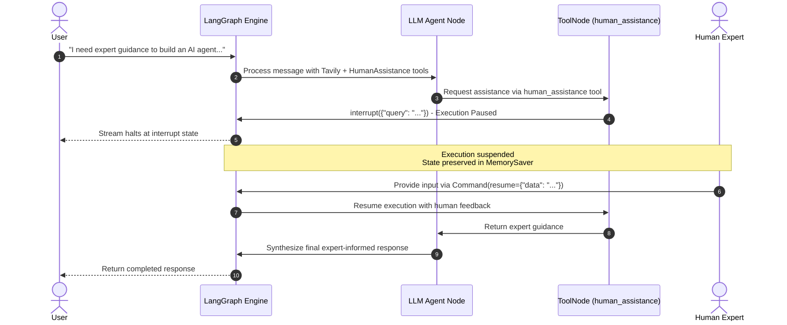

# 🤝 Human-in-the-Loop (HITL) Workflows with LangGraph

This module demonstrates how to implement **Human-in-the-Loop (HITL)** design patterns in LangGraph using the modern `interrupt` and `Command` primitives. It enables autonomous agents to safely pause execution, request guidance, authorization, or domain expertise from a human, and resume execution seamlessly from the exact checkpoint.

---

## 📌 Key Architectural Concepts

1. **Active Human Escalation (`interrupt`)**
   - The graph defines a specialized tool `human_assistance(query: str)` decorated with `@tool`.
   - When the agent encounters a complex problem or an explicit request for human expertise, it invokes this tool, triggering `interrupt({"query": query})`.
   - This suspends the graph execution right inside the `ToolNode`.

2. **State Checkpointing Across Pauses (`MemorySaver`)**
   - Pausing requires graph persistence. A `MemorySaver` checkpointer is compiled into the graph.
   - State and conversation history are indexed under a specific `thread_id`.
   - The execution halts gracefully without losing in-flight state or unhandled tool calls.

3. **Resuming Execution (`Command(resume=...)`)**
   - Once human input is collected out-of-band, execution is resumed by invoking `.stream()` with a `Command(resume={"data": human_response})` targeted to the same `thread_id`.
   - The tool receives the resumed data as its return value and returns control to the agent to synthesize the final answer.

4. **Safe Tool Calling Patterns**
   - Parallel tool calling is explicitly disabled during interruptible tool flows to prevent accidental duplicate invocations when resuming execution.

---

## 🔄 Interaction Flow



---

## 📂 File Structure

| File | Description |
| :--- | :--- |
| `humanintheloop.ipynb` | End-to-end interactive notebook demonstrating graph compilation with checkpointer, triggering `interrupt()`, querying graph state, and resuming via `Command(resume=...)`. |

---

## 🚀 Getting Started

### 1. Environment Configuration
Ensure your root `.env` file contains your credentials:
```env
GROQ_API_KEY=your_groq_api_key
TAVILY_API_KEY=your_tavily_api_key
```

### 2. Run the Notebook
Open and execute [humanintheloop.ipynb](file:///d:/Computer%20Science/Switch/Gen%20AI/LangGraph_CrashCourse_2/2-HumanAssistance/humanintheloop.ipynb):
```bash
jupyter notebook humanintheloop.ipynb
```
