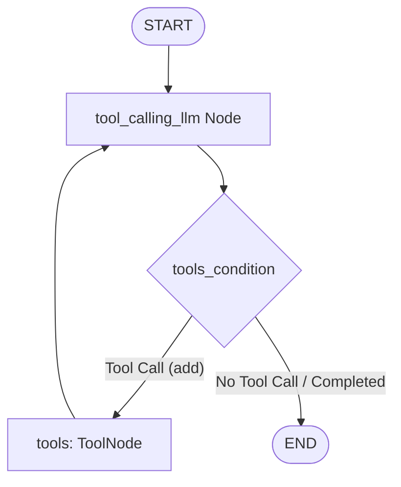

# 🔍 Observability, Tracing & Studio Debugging

This module focuses on **observability, tracing, and visual debugging** of LangGraph agents in production and local development workflows. It integrates **LangSmith** for full-stack telemetry and **LangGraph Studio** / **LangGraph CLI** for visual state inspection and step-by-step graph execution.

---

## 📌 Key Architectural Concepts

1. **Full-Trace Observability with LangSmith**
   - Configures automated tracing to LangSmith by setting:
     - `LANGSMITH_TRACING="true"`
     - `LANGSMITH_PROJECT="Tutorial1"`
   - Tracks execution graphs, LLM latency, token counts, tool invocation inputs/outputs, and potential errors across every invocation.

2. **LangGraph Studio & CLI Integration (`langgraph.json`)**
   - Implements a declarative configuration file (`langgraph.json`) that exposes the compiled graph (`agent.py:tool_agent`) to LangGraph Studio.
   - Allows developers to run the agent in a local visual UI with time-travel debugging, manual state mutation, and interactive step execution.

3. **In-Code Graph Visualization**
   - Generates Mermaid diagram visualizations directly from the compiled graph via:
     ```python
     Image(graph.get_graph().draw_mermaid_png())
     ```

4. **Modular Agent Architecture**
   - Encapsulates the agent building logic in `make_tool_graph()` inside `agent.py`.
   - Utilizes `groq:openai/gpt-oss-120b` via `init_chat_model` with arithmetic tool calling (`add`).

---

## 🔄 Graph Architecture



---

## 📂 File Structure

| File | Description |
| :--- | :--- |
| `agent.py` | Standalone Python module defining and compiling `tool_agent` for direct export to LangGraph Studio and external services. |
| `debugging.ipynb` | Jupyter notebook demonstrating graph compilation, Mermaid diagram rendering, query execution, and LangSmith trace generation. |
| `langgraph.json` | Configuration file connecting the compiled graph `tool_agent` with local environment variables and dependencies for LangGraph Studio / CLI. |

---

## 🚀 Getting Started

### 1. Environment Configuration
Add the following keys to your `.env` file:
```env
GROQ_API_KEY=your_groq_api_key
LANGSMITH_API_KEY=your_langsmith_api_key
LANGSMITH_TRACING=true
LANGSMITH_PROJECT=Tutorial1
```

### 2. Run the Notebook
Execute [debugging.ipynb](file:///d:/Computer%20Science/Switch/Gen%20AI/LangGraph_CrashCourse_2/3-Debugging/debugging.ipynb) to inspect the graph and send test traces to your LangSmith dashboard:
```bash
jupyter notebook debugging.ipynb
```

### 3. Launch LangGraph Studio (Optional)
If you have `langgraph-cli` installed, launch the visual studio locally:
```bash
cd 3-Debugging
langgraph dev
```
Open the provided browser URL to inspect, step through, and debug graph executions visually.
