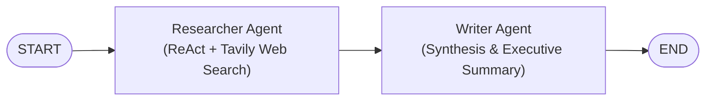
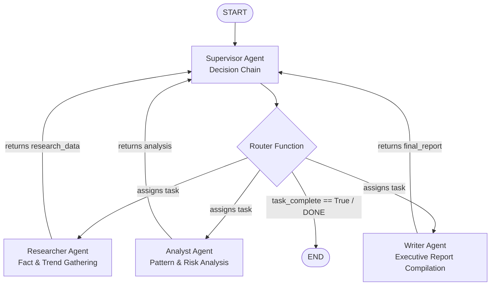

# 👥 Multi-AI Agent Architectures in LangGraph

This module demonstrates advanced **Multi-Agent Orchestration Patterns** built on LangGraph and high-throughput Groq models. It explores two distinct multi-agent paradigms:
1. **Sequential Multi-Agent Pipeline (Pipeline Pattern)**
2. **Hierarchical Supervisor-Worker Architecture (Hub-and-Spoke Pattern)**

---

## 📌 Architecture 1: Sequential Multi-Agent Pipeline

In the sequential workflow, specialist agents execute their tasks in a linear handoff pipeline.



### Components
- **Researcher Agent**: A ReAct agent configured with `TavilySearch` to query the live web, extract key findings, and accumulate raw intelligence into graph state.
- **Writer Agent**: A specialized prompt agent that digests the collected findings and produces a polished summary report.
- **Workflow Flow**: `START` ➔ `Researcher` ➔ `Writer` ➔ `END`.

---

## 📌 Architecture 2: Hierarchical Supervisor-Worker Architecture

In the supervisor-managed workflow, a centralized **Supervisor Agent** dynamically plans, delegates, and oversees work performed by three specialized domain agents until the objective is accomplished.



### Key Elements:
1. **State Definition (`SupervisorState`)**:
   Tracks shared context across all workers:
   - `next_agent`: Targeted agent name or `"end"`.
   - `research_data`: Raw domain facts and findings.
   - `analysis`: Strategic risks, patterns, and implications.
   - `final_report`: Complete, formatted executive markdown report.
   - `task_complete`: Completion flag.
   - `current_task`: Active user objective.

2. **Supervisor Agent**:
   - Built using LangChain Expression Language (LCEL) chain: `ChatPromptTemplate | llm`.
   - Evaluates the current state flags (`has_research`, `has_analysis`, `has_report`) and conversation history.
   - Outputs the next best agent to invoke (`researcher`, `analyst`, `writer`, or `DONE`).

3. **Specialized Workers**:
   - 🔍 **Researcher**: Collects key background, market trends, statistics, and concrete case studies.
   - 📊 **Analyst**: Evaluates research for strategic implications, risk patterns, and recommendations.
   - ✍️ **Writer**: Synthesizes all gathered insights into a timestamped, professional executive report.

4. **Dynamic Routing**:
   - A router function (`router`) evaluates `state["next_agent"]` and `task_complete`.
   - Conditional edges loop back from workers to the supervisor until the task is successfully finalized.

---

## 📂 File Structure

| File | Description |
| :--- | :--- |
| `multiaiagent.ipynb` | Comprehensive Jupyter notebook containing both the Sequential Pipeline and the full Supervisor Multi-Agent system with formatted report outputs. |

---

## 🚀 Getting Started

### 1. Environment Configuration
Ensure your root `.env` file contains your credentials:
```env
GROQ_API_KEY=your_groq_api_key
TAVILY_API_KEY=your_tavily_api_key
```

### 2. Run the Notebook
Open and execute [multiaiagent.ipynb](file:///d:/Computer%20Science/Switch/Gen%20AI/LangGraph_CrashCourse_2/Agents/multiaiagent.ipynb):
```bash
jupyter notebook multiaiagent.ipynb
```
